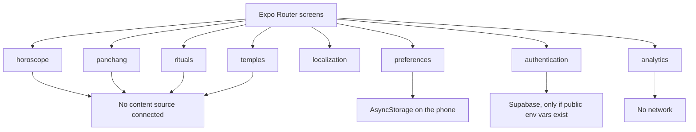

# Architecture

The app is one Expo React Native client. There is no separate web app and no custom microservice. PostgreSQL, authentication, and future content APIs belong in Supabase when a project is created. Until then the client runs entirely on the device.

## Stack

| Concern           | Choice                                                      |
| ----------------- | ----------------------------------------------------------- |
| UI                | React Native 0.86 and Expo SDK 57                           |
| Language          | TypeScript, `strict` enabled                                |
| Navigation        | Expo Router file routes and the stable `Tabs` navigator     |
| Language catalogs | Typed dictionaries in `src/modules/localization`            |
| Preferences       | AsyncStorage key `sg.preferences.v1`                        |
| Accounts          | `@supabase/supabase-js`, not called on startup              |
| Analytics         | In-app no-op interface                                      |
| Tests             | Jest with `jest-expo/android`                               |
| Lint and format   | ESLint flat config from `eslint-config-expo`, plus Prettier |

React Compiler is enabled because that is the Expo SDK 57 template default. It stays on until a concrete compiler bug forces a change.

`babel.config.js` is present so Jest loads `babel-preset-expo`. Metro can start without that file, but the Jest preset does not strip React Native's setup syntax unless Babel is configured.

## Navigation

`src/app/_layout.tsx` is a stack. The tab group hides its own parent header. Settings is a stack screen so the tab bar stays at five items, which is the practical maximum on a phone.

| Route               | Role                                           |
| ------------------- | ---------------------------------------------- |
| `/(tabs)` Home      | Explains the empty state and links to Settings |
| `/(tabs)/horoscope` | Saves a Rashi preference and shows no reading  |
| `/(tabs)/panchang`  | States that no calculation is available        |
| `/(tabs)/rituals`   | Renders the empty reviewed list                |
| `/(tabs)/temples`   | Renders the empty directory                    |
| `/settings`         | Language and the inactive account section      |

The template's `unstable-native-tabs` navigator was not used. The stable tabs API is enough for this shell and is less likely to change under a content milestone.

## Module boundaries

Each module exposes a small API from `index.ts`. Screens should not reach past that file.

**Horoscope.** `RASHIS` is the twelve category labels. `getDailyHoroscope` returns unavailable until `PUBLISHED_DAILY_READINGS` contains a reviewed row for that civil date, Rashi, and language. The reader does not accept a birth date. A development example in `src/modules/horoscope/daily.ts` is labeled as an example and is rejected at publication. Today links to `/horoscope/[rashiId]` for every Rashi. Missing days and missing translations stay empty.

**Panchang.** `PanchangQuery` is the contract for a later source: civil date, latitude, longitude, and IANA time zone. `getPanchang` ignores the query and returns unavailable. The screen calls `getPanchangAvailability` so it does not invent a location. A future implementation must use the selected place. It must not assume every user is in `Asia/Kolkata`, and it must not estimate a value in the client unless the chosen library and its license are accepted in a new decision.

**Rituals.** `listReviewedRituals` returns an empty array. A record, when one exists, needs reviewed title and steps. The shell has no renderer for steps, so an empty list is the only honest state.

**Temples.** `listMatajiTemples` returns an empty array. A future row needs a reviewed name, locality, and coordinates. Do not seed it from an unreviewed export.

**Localization.** `resolveLocale` prefers the saved language, then the device language, then English. `messages` is typed so a missing string fails `npm run typecheck`. `expo-localization` reads the language tag only. It does not request GPS permission.

**Preferences.** The stored object has `locale` and `rashiId` only. Unknown keys, including any future birth fields accidentally written by an older experiment, are dropped on read. Corrupt JSON falls back to defaults. Sync to an account is not implemented. The storage module is the place to add it later, after sign-in exists.

**Authentication.** `parseSupabasePublicConfig` requires both `EXPO_PUBLIC_SUPABASE_URL` and `EXPO_PUBLIC_SUPABASE_ANON_KEY`. `getSupabaseClient` returns null without them, and it does not persist a session. The Settings screen does not offer a sign-in button in this version, even if the variables are present, because there is no secure session storage and no sign-in flow.

**Analytics.** `noopAnalytics.track` records nothing. The event types allow a language code and a boolean for whether a Rashi is selected. They do not allow the Rashi id, a user id, or a location. A vendor, if chosen later, has to fit those types or the types have to be reviewed again.

## Data

Migrations in `supabase/migrations` create the content review tables, private preferences, and live puja bookings. A later migration should still expect:

- reviewed daily Rashi text in `content.daily_readings`, keyed by civil date, Rashi, and language, with a reviewer who is not the author
- a Panchang snapshot or a server-side calculation owned by an accepted library, keyed by date and location
- rituals with review metadata
- temples with review metadata
- user preferences joined to `auth.users` only after accounts exist
- live puja services, private priest records, and family bookings as described in [PUJA_BOOKING.md](PUJA_BOOKING.md)

Row Level Security has to be designed with those tables. The client must keep using the anon key, never the service-role key.

## Why the web dependencies are still installed

`react-native-web` and `react-dom` come from the Expo template. Expo Router lists them as optional peers. This milestone does not add web screens, and the README does not treat web as a launch target. Removing those packages is a separate decision if the CLI starts treating them as required.

## Fonts

The interface uses the Android system font. Noto fonts on current Android releases cover the ten scripts in this app. A custom Latin-only font would break Hindi and the other Indic scripts, so none is embedded.

## Dependencies, licenses, and cost

Direct dependencies declare MIT, except TypeScript, which declares Apache-2.0. Confirm those license files again before a store submission. The app itself has no `LICENSE` file yet. That is an open decision.

No SDK in this milestone sends content or analytics off the device. These services can cost money later, and none of them is configured now:

| Service                     | When it costs money                                                                                                                                                                                      |
| --------------------------- | -------------------------------------------------------------------------------------------------------------------------------------------------------------------------------------------------------- |
| Supabase                    | The client library is free. A hosted project has a free tier (database, auth, egress, and monthly active users are capped). Free projects pause after a week of inactivity. Paid plans start above that. |
| Expo Application Services   | The SDK is free. Cloud builds, submission, and updates have a free tier and then usage charges. A local `npm run android` session does not use EAS.                                                      |
| Google Play Console         | A one-time registration fee (currently US$25) before a public listing. Confirm the fee on the Play Console signup page.                                                                                  |
| Panchang or horoscope data  | Not selected. A commercial API would be a contract. Swiss Ephemeris is AGPL and needs a license review before it is added.                                                                               |
| Maps or places              | Not used. Google Places terms restrict what can be stored. Do not scrape a directory into the temple module.                                                                                             |
| Ads, YouTube, notifications | Later phases. Each SDK or quota can add cost and a privacy review.                                                                                                                                       |

`npm audit --omit=dev` reported 62 vulnerabilities (16 moderate, 46 high, 0 critical) in the Expo, Metro, React Native, and Jest toolchain. The full tree, including development tools, reported 66 (16 moderate, 50 high). They were not cleared with `npm audit fix --force`, because that can break the SDK pin. Re-check before a store build and patch inside the versions Expo supports.
